# AI-Based Crop-Safe Path Planning for an Autonomous Potato-Field Robot

**Artificial Intelligence - Group Coding Assignment** · Python · NumPy · Matplotlib

A simulated robot plans a route across a potato field from a start cell to a monitoring location. It never enters potato rows, crop-protection zones or obstacles, prefers routes that stay away from the crops, and when it meets an obstacle it did not know about, it detects it, updates its map and replans with A*.

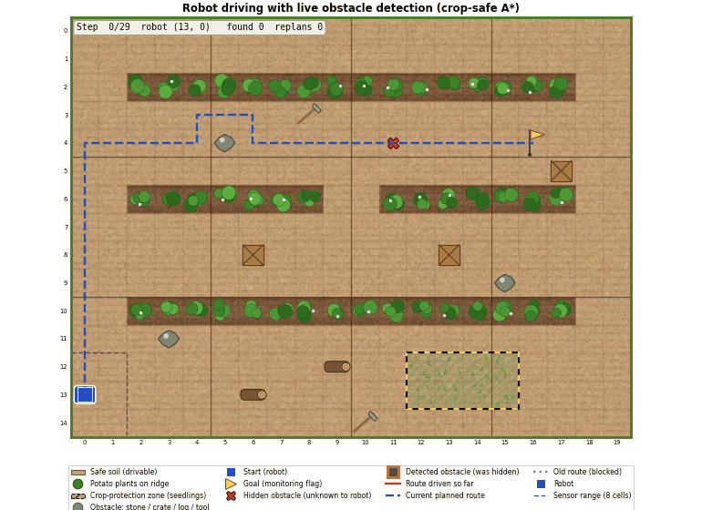

---

## Contents

1. [Group members](#group-members)
2. [How to run](#how-to-run)
3. [Project structure](#project-structure)
4. [Task 1 - Field environment](#task-1---field-environment)
5. [Task 2 - Problem formulation](#task-2---problem-formulation)
6. [Task 3 - Search algorithms](#task-3---search-algorithms)
7. [Task 4 - Crop-safe planning](#task-4---crop-safe-planning)
8. [Task 5 - Obstacle detection and replanning](#task-5---obstacle-detection-and-replanning)
9. [Task 6 - Performance evaluation](#task-6---performance-evaluation)
10. [Observations](#observations)
11. [Automated tests](#automated-tests)
12. [Limitations and possible extensions](#limitations-and-possible-extensions)
13. [References and acknowledgements](#references-and-acknowledgements)

---

## Group members

**Group number:** 8
**Group representative:** Amit Pramanik  
**Contact:** bt24csa038@iiitn.ac.in

| Name | Roll number | Contribution |
|---|---|---|
| _Amit Pramanik_ | _BT24CSA038_ | Set up the field start and goal; Task 4 crop-safe planning; Task 5 obstacle detection and replanning; Git work and repository coordination. |
| _Prayag Bavadiya_ | _BT24CSA037_ | Task 1 field cells, crop rows, protected area, obstacles, and visualization in `field.py`. |
| _Nikhil Makhija_ | _BT24CSA043_ | Task 6 performance evaluation and results. |
| _Gaurav Chockai_ | _BT24CSA023_ | Task 3 BFS, DFS, and Greedy Best-First Search; shared search utilities. |
| _Niraj Visave_ | _BT24CSA041_ | Task 3 A*, UCS, and Manhattan heuristic; compare optimality and search effort. |
| _Affan Maniyar_ | _BT24CSA042_ | Task 2 problem formulation, legal moves, and path costs; integrate modules through `main.py`, update the README, and review final outputs. |

---

## How to run

**Requirements:** Python 3.9 or newer, NumPy, and Matplotlib 3.7 or newer (Pillow, used for the GIF, is installed with Matplotlib). Developed and tested with Python 3.13, NumPy 2.3 and Matplotlib 3.10.

```bash
pip install -r requirements.txt
```

Run every task, print every table and regenerate every screenshot (under a minute, no windows):

```bash
python main.py
```

Other options:

| Command | What it does |
|---|---|
| `python main.py --show` | Same, then opens every figure in a window |
| `python main.py --animate` | Same as `--show`, plus a live animation of the robot replanning |
| `python main.py --gif` | Also saves `screenshots/07_replanning.gif` (about 30 s extra) |

Each part can also be run on its own:

| Command | Task |
|---|---|
| `python field.py` | Task 1 - draw the field |
| `python problem.py` | Task 2 - problem formulation |
| `python -m search.bfs` · `python -m search.dfs` · `python -m search.greedy` · `python -m search.astar` | Task 3 - one algorithm |
| `python -m search.ucs` | Extra baseline - Uniform Cost Search vs BFS and A* on the crop-safe cost |
| `python crop_safe_demo.py` | Task 4 - plain vs crop-safe A*, the trade-off goal and the penalty-weight table |
| `python replanning.py --animate` | Task 5 - hidden obstacle and replanning |
| `python evaluation.py` | Task 6 - comparison tables and charts |
| `python tests/test_project.py` | Automated tests (a few seconds) |

Run the commands from the project folder. The search modules use `python -m` because they live in the `search` package.

---

## Project structure

```
├── main.py              runs every task and saves every screenshot
├── field.py             Task 1: grid, cell types, default field, drawing
├── problem.py           Task 2 + 4: states, actions, transitions, goal test, (crop-safe) path cost
├── search/
│   ├── common.py        SearchResult and path reconstruction, shared by all algorithms
│   ├── bfs.py           Breadth-First Search
│   ├── dfs.py           Depth-First Search
│   ├── heuristics.py    Manhattan distance heuristic
│   ├── greedy.py        Greedy Best-First Search
│   ├── astar.py         A* Search
│   └── ucs.py           Uniform Cost Search (extra baseline: A* with h = 0)
├── crop_safe_demo.py    Task 4: plain vs crop-safe A*, trade-off goal, penalty-weight sweep
├── replanning.py        Task 5: sensing, map update, A* replanning, animation
├── evaluation.py        Task 6: metrics, tables, charts, observations
├── tests/
│   └── test_project.py  automated checks for every claim in this README
├── results/             results_table.md and results.csv (written by evaluation.py)
└── screenshots/         every figure (written by main.py)
```

---

## Task 1 - Field environment

The field is a 15 × 20 grid stored as a NumPy array. Each cell holds one type:

| Cell | Meaning | Robot may enter? |
|---|---|---|
| Safe travel cell | bare soil between rows | yes |
| Potato row | a potato plant | no |
| Crop-protection zone | e.g. seedlings or a freshly sprayed patch | no |
| Obstacle | a stone, crate, log or tool lying in the field | no |
| Hidden obstacle | a real obstacle missing from the robot's map | looks safe until detected |

Layout: three horizontal potato rows (rows 2, 6 and 10) with open headlands at both ends, a crossing gap in the middle row (columns 9-10), one crop-protection zone, ten known obstacles (stones, crates, logs and tools spread through the lanes and headlands) and one hidden stone at (4, 11). The robot starts at (13, 0) and must reach the monitoring point at (4, 16).

The field keeps **two maps**: `grid` is what the robot knows, and `true_grid()` adds the hidden obstacles - the real world. Planning always uses the robot's map; the simulated sensor reads the real one.

**How the field is drawn.** The pictures are made to look like a real field: tilled soil with furrows, potato plants (some flowering) on darker earth ridges, seedlings inside the protection zone behind black-and-yellow warning tape, and each obstacle drawn as what it is - a stone, crate, log or hoe. The robot is shown at the start and a flag marks the monitoring point. Thin lines mark every grid cell and bold lines divide the field into 5 × 5 plots, so any cell can be read off by its (row, column) coordinates.

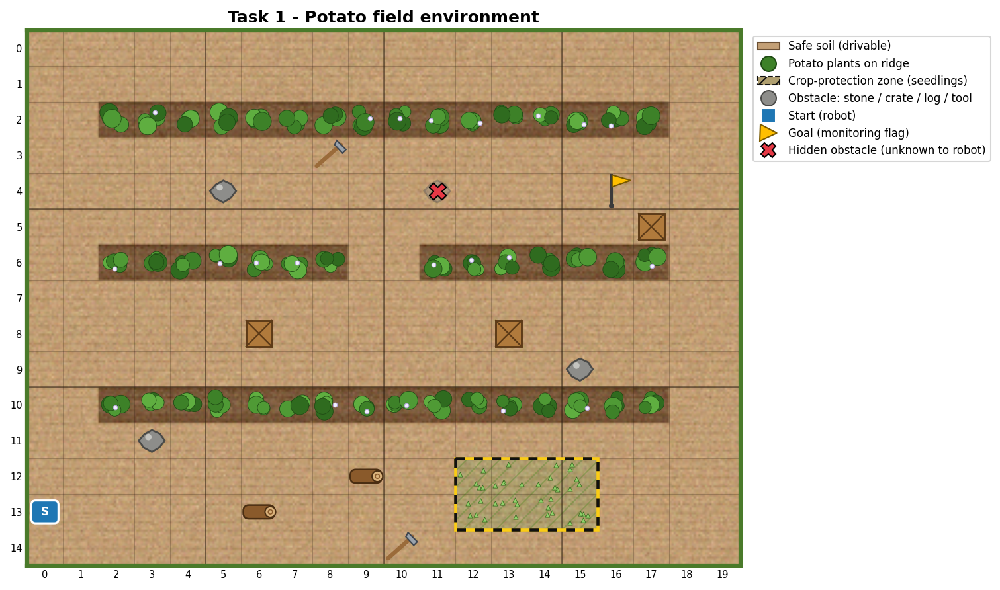

---

## Task 2 - Problem formulation

| Component | Definition |
|---|---|
| **State** | the robot's cell `(row, col)` |
| **Initial state** | `(13, 0)` |
| **Actions** | `Up`, `Down`, `Left`, `Right` - one cell per move (4-directional) |
| **Transition model** | `result((r, c), a) = (r + dr, c + dc)` |
| **Legal move** | the next cell is inside the grid and is a safe cell on the robot's known map |
| **Goal test** | `state == (4, 16)` |
| **Path cost** | sum of step costs: 1 per move, plus a crop-proximity penalty in crop-safe mode (Task 4) |

Movement is 4-directional: it keeps the action set small, matches a robot driving along rows, and makes the Manhattan heuristic exact on an empty field.


---

## Task 3 - Search algorithms

All four algorithms use **graph search**: a cell is never expanded twice, and each cell remembers its parent so the path can be rebuilt from the goal back to the start. "Nodes expanded" counts cells taken off the frontier and expanded.

| Algorithm | Frontier | Picks next | Complete | Optimal |
|---|---|---|---|---|
| **BFS** | FIFO queue | the oldest cell | yes | yes, for number of moves |
| **DFS** | LIFO stack | the newest cell | yes, on a finite grid | no |
| **Greedy Best-First** | priority queue | smallest `h(n)` | yes, on a finite grid | no |
| **A\*** | priority queue | smallest `f(n) = g(n) + h(n)` | yes | yes |

`g(n)` is the cost already paid to reach `n`; `h(n)` is the heuristic estimate from `n` to the goal.

### Heuristic: Manhattan distance

```
h(n) = |row(n) - row(goal)| + |col(n) - col(goal)|
```

- **Admissible:** with 4-directional moves the robot needs at least this many moves even on an empty field, and every move costs at least 1, so `h` never overestimates the true remaining cost.
- **Consistent:** moving to a neighbour changes `h` by at most 1, which is at most the step cost. So A* never needs to reopen a cell, and the first time it expands the goal it has the cheapest path.
- Greedy uses `h` alone, so it rushes towards the goal and can be lured into detours. A* balances `h` against `g`, so it stays optimal.

Ties in A* are broken by smaller `h`, so on equal `f` it expands the cell nearer the goal first.

### Extra baseline: Uniform Cost Search

BFS is optimal only when every move costs the same. With the crop-safe cost (Task 4) moves cost different amounts, so the project also includes **Uniform Cost Search (UCS)**, which expands the cell with the smallest `g(n)`. UCS is exactly A* with `h = 0`, so it is optimal for any non-negative step costs but has no sense of direction.

| Planner (crop-safe cost) | Crop-safe cost | Nodes expanded |
|---|---:|---:|
| BFS | 62 (not optimal) | 209 |
| UCS | 60 (optimal) | 206 |
| A* (crop-safe) | 60 (optimal) | 175 |

A* finds the same optimal cost as UCS with fewer nodes: the heuristic still helps when moves have different costs.

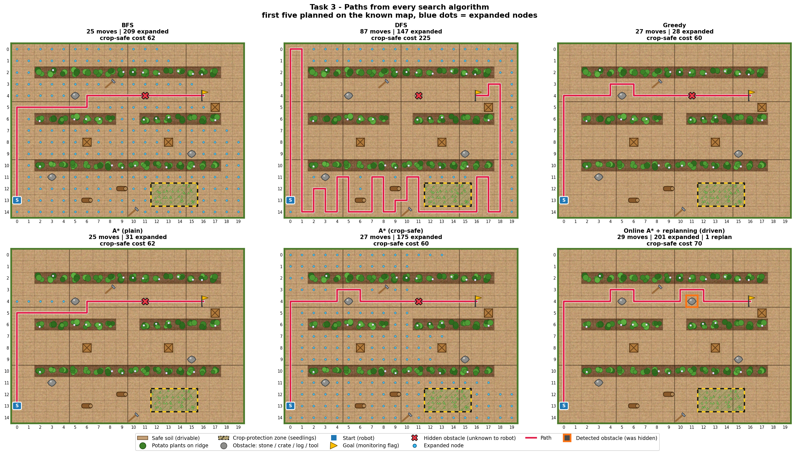

<details>
<summary>Individual screenshots for each algorithm</summary>

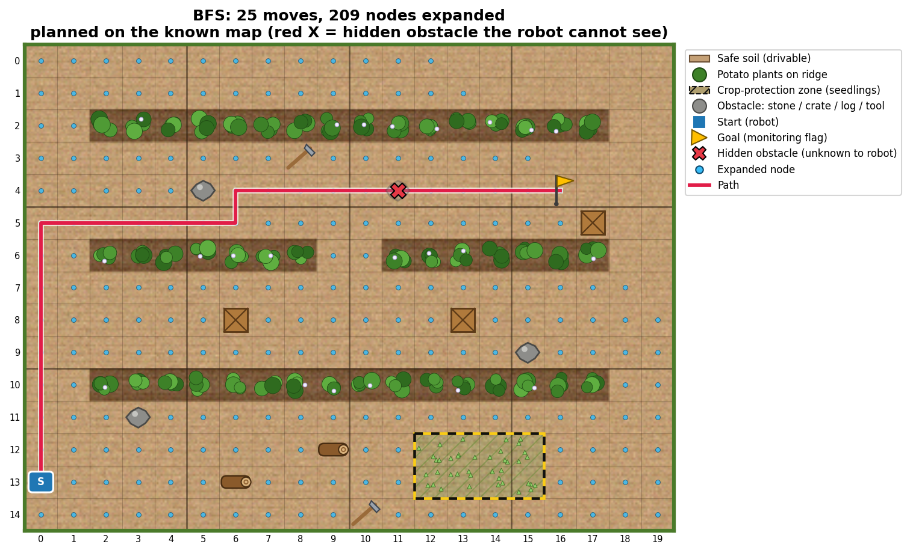

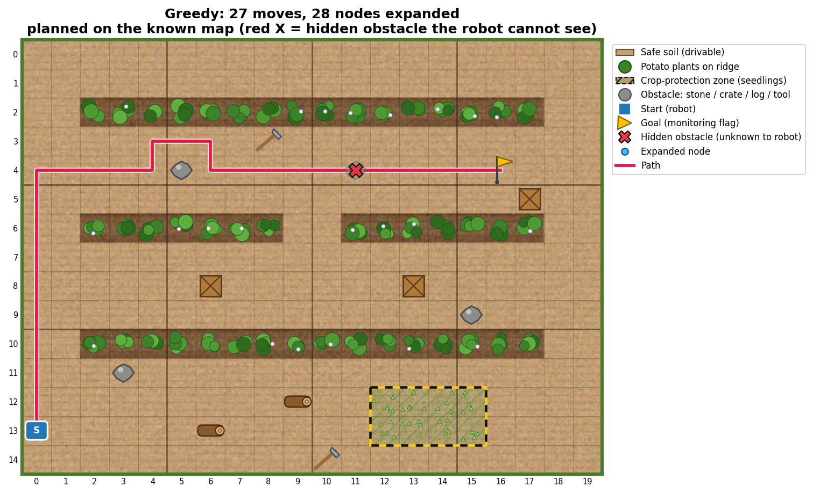

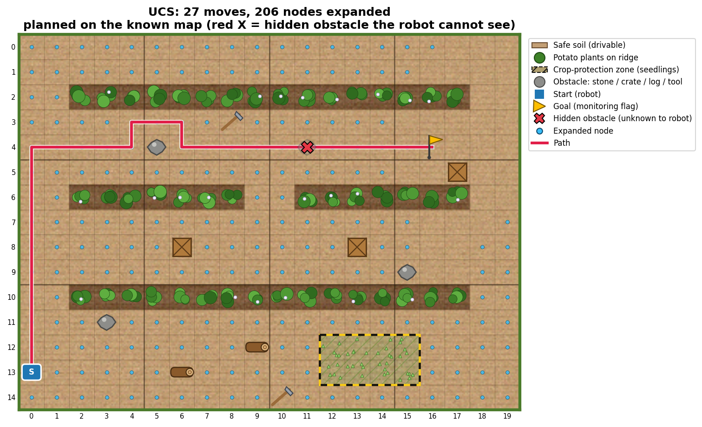

</details>

---

## Task 4 - Crop-safe planning

Safety is handled at two levels:

1. **Hard constraint.** Potato, crop-protection and obstacle cells are never offered as actions (Task 2). No algorithm can produce a path through them.
2. **Soft constraint.** Entering a cell close to a potato or protected cell costs extra:

| Distance to the nearest crop cell (8-neighbourhood, diagonals count) | Extra cost |
|---|---|
| 1 (directly next to a plant) | +3 |
| 2 | +1 |
| 3 or more | 0 |

Diagonals count because a real robot has width and can brush a plant while passing it diagonally. The penalty map is computed once, so a step cost is a single lookup.

Only `step_cost` changes; A* itself is untouched and simply minimises the new cost. Every step still costs at least 1, so Manhattan distance stays admissible and A* stays optimal.

**Result on the default goal (4, 16):** plain A* takes the shortest route, 25 moves, running along row 5 right beside a potato row. Crop-safe A* drives up the left headland and along the middle of the top lane instead: 27 moves, half as many cells next to crops (3 instead of 6), and a crop-safe cost of 60 instead of 62. It accepts 2 extra moves to keep away from the plants. The remaining crop-adjacent cells are the short detour around the stone at (4, 5).


### When the safer route is longer

The default goal already shows a small trade-off: 2 extra moves to halve the time spent beside the crops. The goal at (1, 16) shows a much starker one, because the shortest route there runs along row 1, right beside a potato row:

| Planner | Moves | Cells next to crops | Crop-safe cost |
|---|---:|---:|---:|
| A* (plain) | 28 | 16 | 88 |
| A* (crop-safe) | 30 | 1 | 62 |

Crop-safe A* accepts **2 extra moves** to drive along row 0 instead, cutting the cells next to crops from 16 to 1. This is "safer alternatives are preferred where available" in action.

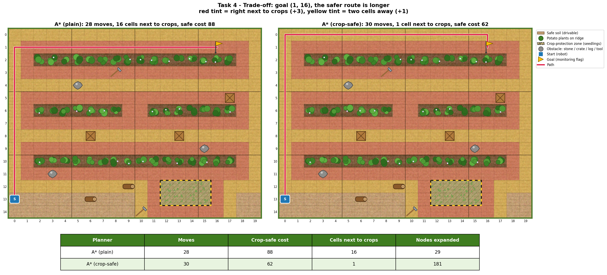

### How strong must the penalty be?

The penalties are multiplied by a weight: 0 is plain A*, 1 is the default (+3 / +1).

| Weight | Default goal: moves | Cells next to crops | Trade-off goal: moves | Cells next to crops |
|---:|---:|---:|---:|---:|
| 0 | 25 | 6 | 28 | 16 |
| 0.05 | 25 | 6 | 28 | 16 |
| 0.1 | 25 | 6 | 30 | 1 |
| 0.5 | 27 | 3 | 30 | 1 |
| 1 (default) | 27 | 3 | 30 | 1 |
| 3 | 27 | 3 | 30 | 1 |

The safer route only wins once the penalty it avoids outweighs the extra moves it costs. On the trade-off goal the safer route avoids 15 crop-adjacent cells for 2 extra moves, so a weight of 0.1 is already enough. On the default goal it avoids only 3 such cells for the same 2 extra moves, so it needs a weight of 0.5. The default weight of 1 is safely above both thresholds. Stronger penalties also make A* expand more nodes (31 at weight 0, 175 at weight 1 and 199 at weight 3 on the default goal), because the heuristic ignores penalties and so becomes a looser estimate.

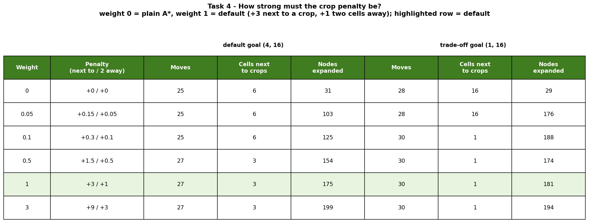

---

## Task 5 - Obstacle detection and replanning

The robot starts with a map that does not contain the hidden obstacle at (4, 11), and runs a **sense - update - replan - act** loop:

1. **Plan** a route with crop-safe A* on its known map.
2. **Sense** the 8 cells around it in the real world (simulated sensor, radius 1).
3. **Update** its map with any obstacle it did not know about.
4. **Replan** with A* from its current cell, but only if a new obstacle lies on the remaining route.
5. **Act:** move one cell, then repeat until the goal is reached or no route exists.

Because the sensor sees one cell ahead, the robot always detects an obstacle before it could drive into it.

**Result:** the initial 27-move plan runs straight through the hidden stone. At step 21 the robot, at (4, 10), senses it at (4, 11), replans once, detours over row 3 and reaches the goal in 29 moves with a crop-safe cost of 70 - exactly as good as an A* run that knew about the stone from the start.

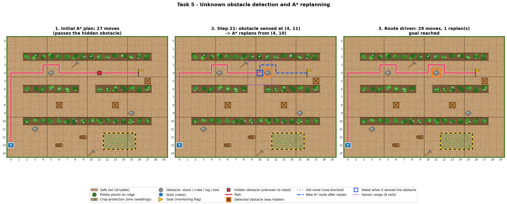
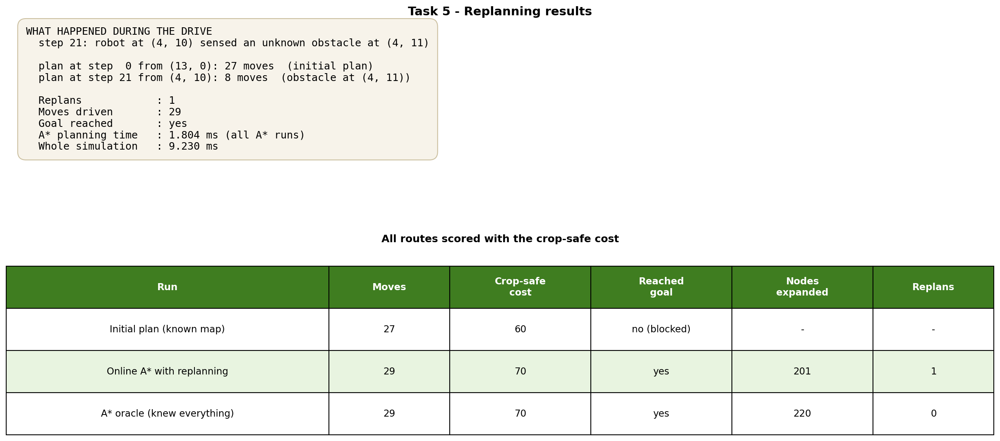

**Testing.** The loop was also checked with no hidden obstacles (0 replans), an obstacle off the route (0 replans), several hidden obstacles (2 replans), a goal sealed in by hidden obstacles (stops and reports failure), and hundreds of random fields with several hidden obstacles each. The robot never drove into an obstacle, and it reached the goal in exactly the fields where the goal was reachable. These checks are part of the [automated tests](#automated-tests).

---

## Task 6 - Performance evaluation

All planners run on the same field, and every route is scored with the **same crop-safe cost** so the numbers are comparable. One run takes about a millisecond or less, so each time is the **median of 30 runs**. Exact times vary between machines and runs; the other columns are deterministic.

### Default field

| Algorithm | Reached goal | Moves | Crop-safe cost | Cells next to crops | Nodes expanded | Time (ms) | Replans | Hits hidden obstacle |
|---|---:|---:|---:|---:|---:|---:|---:|---:|
| BFS | yes | 25 | 62 | 6 | 209 | 0.724 | 0 | yes |
| DFS | yes | 87 | 225 | 35 | 147 | 0.587 | 0 | no |
| UCS | yes | 27 | 60 | 3 | 206 | 1.015 | 0 | yes |
| Greedy | yes | 27 | 60 | 3 | 28 | 0.181 | 0 | yes |
| A* (plain) | yes | 25 | 62 | 6 | 31 | 0.221 | 0 | yes |
| A* (crop-safe) | yes | 27 | 60 | 3 | 175 | 0.916 | 0 | yes |
| Online A* + replanning | yes | 29 | 70 | 6 | 201 | 1.208 | 1 | no |

_The first six planners plan once on the known map. "Reached goal" means their plan reaches the goal on that map; "Hits hidden obstacle" shows whether the real robot would drive into the unknown obstacle. For online A*, time and nodes are summed over every A* run, including the replan._

### Average over 100 random layouts

To check the trends are not an accident of one map, each of 100 layouts (fixed random seed 42) adds 20 random known obstacles and 3 random hidden obstacles. "For real" means the plan reaches the goal without hitting a hidden obstacle.

| Algorithm | Reached goal on known map (%) | Reached goal for real (%) | Moves | Crop-safe cost | Nodes expanded | Time (ms) | Replans |
|---|---:|---:|---:|---:|---:|---:|---:|
| BFS | 99.0 | 63.0 | 26.1 | 77.4 | 173.2 | 0.926 | 0 |
| DFS | 99.0 | 29.0 | 75.7 | 223.6 | 122.1 | 0.813 | 0 |
| UCS | 99.0 | 64.0 | 27.8 | 70.7 | 175.5 | 1.477 | 0 |
| Greedy | 99.0 | 65.0 | 28.9 | 77.7 | 35.5 | 0.293 | 0 |
| A* (plain) | 99.0 | 61.0 | 26.1 | 76.8 | 47.6 | 0.398 | 0 |
| A* (crop-safe) | 99.0 | 67.0 | 28.3 | 70.7 | 155.7 | 1.370 | 0 |
| Online A* + replanning | 97.0 | 97.0 | 30.0 | 75.3 | 186.5 | 1.720 | 0.4 |


<details>
<summary>Tables as a figure</summary>

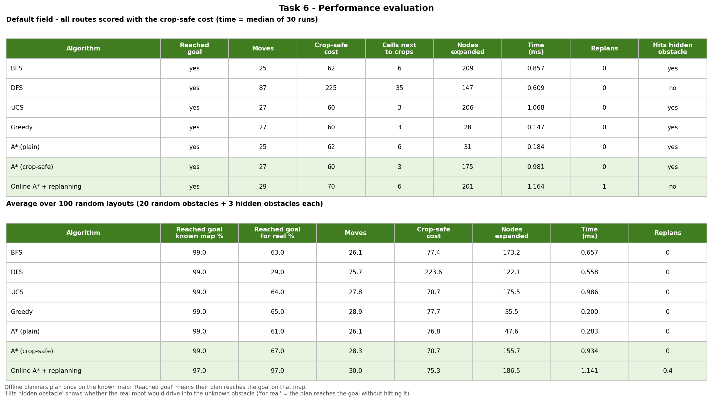

</details>

---

## Observations

- **BFS** finds the shortest route (25 moves) but expands 209 nodes, more than any other planner: it explores the field ring by ring with no sense of direction.
- **DFS** reaches the goal, but its route is 87 moves long - 3.5 times the shortest - and passes 35 cells next to crops. DFS is not optimal.
- **Greedy** expands only 28 nodes, the fewest, but its route is 27 moves: it heads straight for the goal, runs into the stone at (4, 5) and has to detour. Fast, not optimal.
- **Plain A\*** matches BFS's 25 moves while expanding 31 nodes, 85% fewer than BFS. This is the value of an admissible heuristic.
- **UCS vs BFS vs A\* on the crop-safe cost.** BFS's route costs 62 because BFS ignores step costs. UCS finds the cheapest route (60) but expands 206 nodes; crop-safe A* finds the same cost with 175, 15% fewer. Over 100 random layouts UCS and crop-safe A* average exactly the same cost (70.7), as both are optimal, while A* expands fewer nodes (156 vs 176).
- **Crop-safe A\*** has the lowest crop-safe cost (60, tied with UCS) and passes 3 cells next to crops instead of 6, for 2 extra moves (27 instead of 25). The price is also more search, 175 nodes instead of 31, because the Manhattan heuristic does not account for penalties and so guides the search less sharply.
- **Safety costs distance, and the robot pays it when it is worth it.** At the trade-off goal (1, 16) crop-safe A* takes 2 extra moves to cut the cells next to crops from 16 to 1. The penalty-weight table shows the safer route wins from weight 0.1 there and from 0.5 on the default goal, both below the default of 1.
- **Hidden obstacles defeat offline planning.** BFS, UCS, Greedy and both A* variants plan straight through the hidden stone; DFS misses it only by chance. Over 100 random layouts, offline crop-safe A* would really reach the goal in only 67% of them. **Online A\* with replanning** reaches it in 97% - every layout where the goal is reachable at all - at a small cost in extra moves and nodes.
- **Times are all around a millisecond or less** on this grid, so the number of expanded nodes is the more meaningful measure of effort. Time follows nodes expanded: Greedy and plain A* are fastest because they expand the fewest nodes, while UCS and crop-safe A* are slower because they expand more nodes and each expansion also pays for a priority-queue operation.

---

## Automated tests

```bash
python tests/test_project.py
```

No extra library is needed; `python -m pytest tests` also works if pytest is installed. All eight tests pass in a few seconds:

| Test | What it checks |
|---|---|
| `test_every_algorithm_gives_a_valid_crop_safe_path` | Every algorithm, with plain and crop-safe cost, returns a path from start to goal made of single 4-directional steps on safe cells only, and never expands a cell twice |
| `test_optimality_on_random_fields` | On 200 random fields, plain A* matches BFS's move count, crop-safe A* matches UCS's cost, and no other planner finds a cheaper route |
| `test_manhattan_heuristic_is_admissible` | From every safe cell, Manhattan distance is never larger than the true cheapest crop-safe cost to the goal |
| `test_unreachable_goal_is_reported_not_crashed` | With the goal walled in, every planner and the replanning robot report failure instead of crashing |
| `test_default_replanning_scenario` | The initial plan runs through the hidden stone; the robot senses it from an adjacent cell, replans exactly once, never enters it and reaches the goal |
| `test_replanning_never_hits_an_obstacle` | On 200 random fields with hidden obstacles, the robot never enters a real obstacle and reaches the goal exactly when it is reachable |
| `test_safer_route_can_be_longer` | At goal (1, 16) the crop-safe route is longer but has fewer cells next to crops |
| `test_path_cost_rejects_an_invalid_path` | A path that jumps over a cell is rejected with a clear error |

The tests were checked by breaking the code on purpose: an inflated heuristic makes the admissibility and optimality tests fail, and a zero crop penalty makes the trade-off test fail.

---

## Limitations and possible extensions

- 4-directional movement only; 8-directional movement would need a different heuristic (octile or Chebyshev distance) and diagonal step costs.
- The sensor is perfect and has a fixed radius of 1; a real sensor has noise and a limited field of view.
- Obstacles are static once detected; moving obstacles would need replanning on every step or algorithms such as D\* Lite, which reuse previous search effort.
- A heuristic that includes a lower bound on the crop penalty could reduce the extra nodes crop-safe A* expands.

---

## References and acknowledgements

- S. Russell and P. Norvig, *Artificial Intelligence: A Modern Approach*, 4th ed. - search problem formulation, BFS, DFS, Greedy Best-First and A*, admissible and consistent heuristics.
- [NumPy documentation](https://numpy.org/doc/) and [Matplotlib documentation](https://matplotlib.org/stable/) - grid representation, plotting, tables and `FuncAnimation`.
- Course lecture material on uninformed and informed search.
- Parts of the code were developed with the help of an AI coding assistant (Claude, by Anthropic). Every part was tested, and all group members reviewed it and can explain how it works.