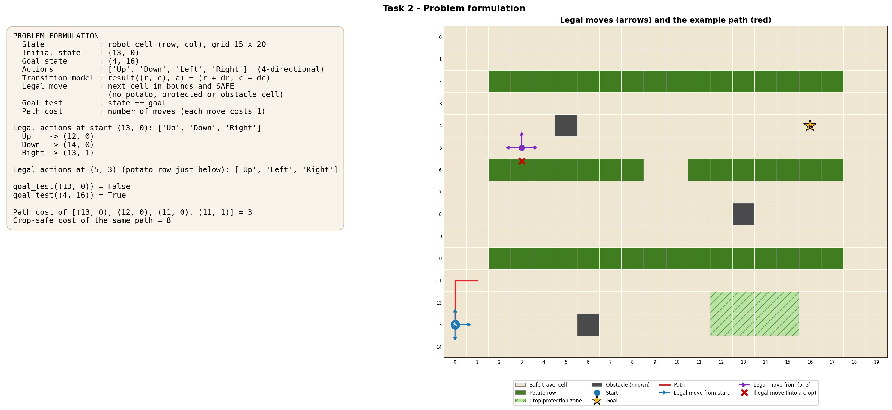
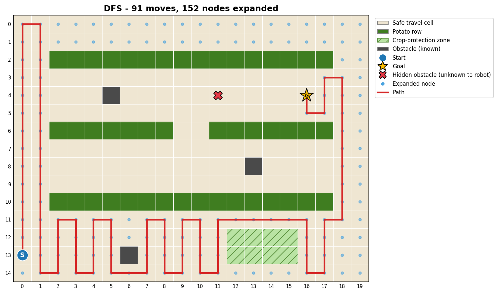
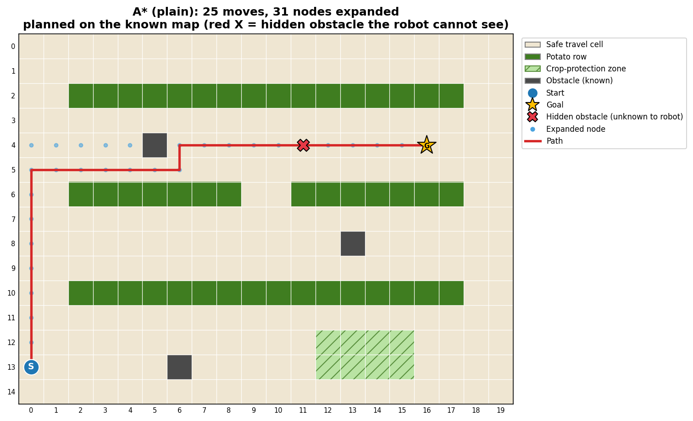
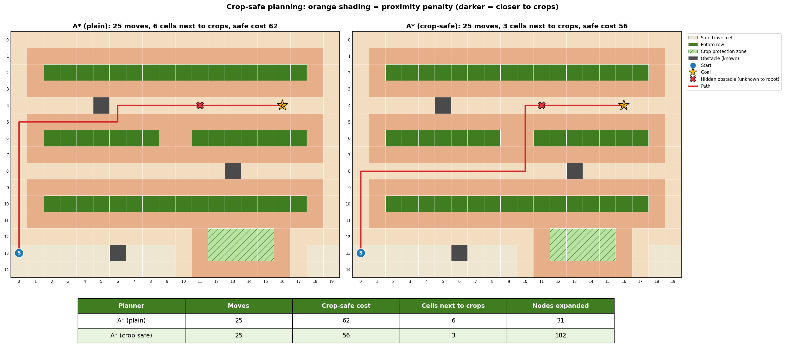
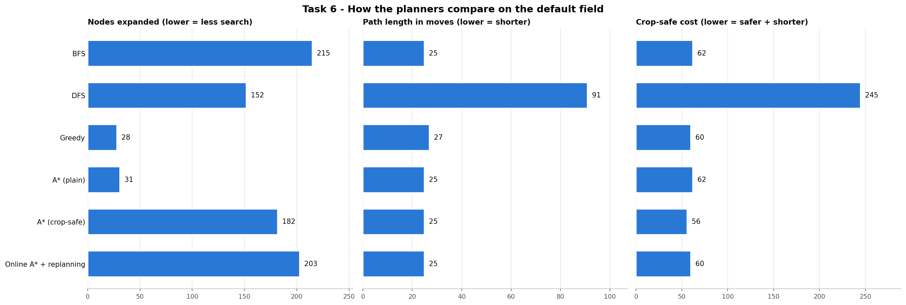

# AI-Based Crop-Safe Path Planning for an Autonomous Potato-Field Robot

**Artificial Intelligence - Group Coding Assignment** · Python · NumPy · Matplotlib

A simulated robot plans a route across a potato field from a start cell to a monitoring location. It never enters potato rows, crop-protection zones or obstacles, prefers routes that stay away from the crops, and when it meets an obstacle it did not know about, it detects it, updates its map and replans with A*.


---

## Contents

1. [Group members](#group-members)
2. [How to run](#how-to-run)
3. [Project structure](#project-structure)
4. [Task 1 - Field environment](#task-1---field-environment)
5. [Task 2 - Problem formulation](#task-2---problem-formulation)
6. [Task 3 - Search algorithms](#task-3---search-algorithms)
7. [Task 4 - Crop-safe planning](#task-4---crop-safe-planning)
8. [Task 5 - Obstacle detection and replanning](#task-5---obstacle-detection-and-replanning)
9. [Task 6 - Performance evaluation](#task-6---performance-evaluation)
10. [Observations](#observations)
11. [Limitations and possible extensions](#limitations-and-possible-extensions)
12. [References and acknowledgements](#references-and-acknowledgements)

---

## Group members

**Group number:** XX

| Name | Roll number | Contribution |
|---|---|---|
| _Name 1_ | _Roll no._ | _to be added_ |
| _Name 2_ | _Roll no._ | _to be added_ |
| _Name 3_ | _Roll no._ | _to be added_ |
| _Name 4_ | _Roll no._ | _to be added_ |
| _Name 5_ | _Roll no._ | _to be added_ |
| _Name 6_ | _Roll no._ | _to be added_ |

---

## How to run

**Requirements:** Python 3.9 or newer, NumPy, and Matplotlib 3.7 or newer (Pillow, used for the GIF, is installed with Matplotlib). Developed and tested with Python 3.13, NumPy 2.3 and Matplotlib 3.10.

```bash
pip install -r requirements.txt
```

Run every task, print every table and regenerate every screenshot (about 15 seconds, no windows):

```bash
python main.py
```

Other options:

| Command | What it does |
|---|---|
| `python main.py --show` | Same, then opens every figure in a window |
| `python main.py --animate` | Same as `--show`, plus a live animation of the robot replanning |
| `python main.py --gif` | Also saves `screenshots/07_replanning.gif` (about 30 s extra) |

Each part can also be run on its own:

| Command | Task |
|---|---|
| `python field.py` | Task 1 - draw the field |
| `python problem.py` | Task 2 - problem formulation |
| `python -m search.bfs` · `python -m search.dfs` · `python -m search.greedy` · `python -m search.astar` | Task 3 - one algorithm |
| `python crop_safe_demo.py` | Task 4 - plain vs crop-safe A* |
| `python replanning.py --animate` | Task 5 - hidden obstacle and replanning |
| `python evaluation.py` | Task 6 - comparison tables and charts |

Run the commands from the project folder. The search modules use `python -m` because they live in the `search` package.

---

## Project structure

```
├── main.py              runs every task and saves every screenshot
├── field.py             Task 1: grid, cell types, default field, drawing
├── problem.py           Task 2 + 4: states, actions, transitions, goal test, (crop-safe) path cost
├── search/
│   ├── common.py        SearchResult and path reconstruction, shared by all algorithms
│   ├── bfs.py           Breadth-First Search
│   ├── dfs.py           Depth-First Search
│   ├── heuristics.py    Manhattan distance heuristic
│   ├── greedy.py        Greedy Best-First Search
│   └── astar.py         A* Search
├── crop_safe_demo.py    Task 4: plain vs crop-safe A*
├── replanning.py        Task 5: sensing, map update, A* replanning, animation
├── evaluation.py        Task 6: metrics, tables, charts, observations
├── results/             results_table.md and results.csv (written by evaluation.py)
└── screenshots/         every figure (written by main.py)
```

---

## Task 1 - Field environment

The field is a 15 × 20 grid stored as a NumPy array. Each cell holds one type:

| Cell | Meaning | Robot may enter? |
|---|---|---|
| Safe travel cell | bare soil between rows | yes |
| Potato row | a potato plant | no |
| Crop-protection zone | e.g. seedlings or a freshly sprayed patch | no |
| Obstacle | stone, tool or other object | no |
| Hidden obstacle | a real obstacle missing from the robot's map | looks safe until detected |

Layout: three horizontal potato rows (rows 2, 6 and 10) with open headlands at both ends, a crossing gap in the middle row (columns 9-10), one crop-protection zone, three known obstacles and one hidden obstacle at (4, 11). The robot starts at (13, 0) and must reach the monitoring point at (4, 16).

The field keeps **two maps**: `grid` is what the robot knows, and `true_grid()` adds the hidden obstacles - the real world. Planning always uses the robot's map; the simulated sensor reads the real one.


---

## Task 2 - Problem formulation

| Component | Definition |
|---|---|
| **State** | the robot's cell `(row, col)` |
| **Initial state** | `(13, 0)` |
| **Actions** | `Up`, `Down`, `Left`, `Right` - one cell per move (4-directional) |
| **Transition model** | `result((r, c), a) = (r + dr, c + dc)` |
| **Legal move** | the next cell is inside the grid and is a safe cell on the robot's known map |
| **Goal test** | `state == (4, 16)` |
| **Path cost** | sum of step costs: 1 per move, plus a crop-proximity penalty in crop-safe mode (Task 4) |

Movement is 4-directional: it keeps the action set small, matches a robot driving along rows, and makes the Manhattan heuristic exact on an empty field.



---

## Task 3 - Search algorithms

All four algorithms use **graph search**: a cell is never expanded twice, and each cell remembers its parent so the path can be rebuilt from the goal back to the start. "Nodes expanded" counts cells taken off the frontier and expanded.

| Algorithm | Frontier | Picks next | Complete | Optimal |
|---|---|---|---|---|
| **BFS** | FIFO queue | the oldest cell | yes | yes, for number of moves |
| **DFS** | LIFO stack | the newest cell | yes, on a finite grid | no |
| **Greedy Best-First** | priority queue | smallest `h(n)` | yes, on a finite grid | no |
| **A\*** | priority queue | smallest `f(n) = g(n) + h(n)` | yes | yes |

`g(n)` is the cost already paid to reach `n`; `h(n)` is the heuristic estimate from `n` to the goal.

### Heuristic: Manhattan distance

```
h(n) = |row(n) - row(goal)| + |col(n) - col(goal)|
```

- **Admissible:** with 4-directional moves the robot needs at least this many moves even on an empty field, and every move costs at least 1, so `h` never overestimates the true remaining cost.
- **Consistent:** moving to a neighbour changes `h` by at most 1, which is at most the step cost. So A* never needs to reopen a cell, and the first time it expands the goal it has the cheapest path.
- Greedy uses `h` alone, so it rushes towards the goal and can be lured into detours. A* balances `h` against `g`, so it stays optimal.

Ties in A* are broken by smaller `h`, so on equal `f` it expands the cell nearer the goal first.


<details>
<summary>Individual screenshots for each algorithm</summary>






</details>

---

## Task 4 - Crop-safe planning

Safety is handled at two levels:

1. **Hard constraint.** Potato, crop-protection and obstacle cells are never offered as actions (Task 2). No algorithm can produce a path through them.
2. **Soft constraint.** Entering a cell close to a potato or protected cell costs extra:

| Distance to the nearest crop cell (8-neighbourhood, diagonals count) | Extra cost |
|---|---|
| 1 (directly next to a plant) | +3 |
| 2 | +1 |
| 3 or more | 0 |

Diagonals count because a real robot has width and can brush a plant while passing it diagonally. The penalty map is computed once, so a step cost is a single lookup.

Only `step_cost` changes; A* itself is untouched and simply minimises the new cost. Every step still costs at least 1, so Manhattan distance stays admissible and A* stays optimal.

**Result:** plain A* drives along row 5, right beside a potato row. Crop-safe A* takes the middle lanes instead: the same 25 moves, half as many cells next to crops (3 instead of 6), and a crop-safe cost of 56 instead of 62. The three remaining crop-adjacent cells are the unavoidable crossing through the gap in the middle row.



---

## Task 5 - Obstacle detection and replanning

The robot starts with a map that does not contain the hidden obstacle at (4, 11), and runs a **sense - update - replan - act** loop:

1. **Plan** a route with crop-safe A* on its known map.
2. **Sense** the 8 cells around it in the real world (simulated sensor, radius 1).
3. **Update** its map with any obstacle it did not know about.
4. **Replan** with A* from its current cell, but only if a new obstacle lies on the remaining route.
5. **Act:** move one cell, then repeat until the goal is reached or no route exists.

Because the sensor sees one cell ahead, the robot always detects an obstacle before it could drive into it.

**Result:** at step 18 the robot, at (5, 10), senses the obstacle at (4, 11). It replans once and reaches the goal in 25 moves - exactly as good as an A* run that knew about the obstacle from the start.


**Testing.** The loop was also checked with no hidden obstacles (0 replans), an obstacle off the route (0 replans), several hidden obstacles (2 replans), a goal sealed in by hidden obstacles (stops and reports failure), and 400 random fields with 25 hidden obstacles each. The robot never drove into an obstacle, and it reached the goal in exactly the fields where the goal was reachable.

---

## Task 6 - Performance evaluation

All planners run on the same field, and every route is scored with the **same crop-safe cost** so the numbers are comparable. One run takes well under a millisecond, so each time is the **median of 30 runs**. Exact times vary between machines and runs; the other columns are deterministic.

### Default field

| Algorithm | Reached goal | Moves | Crop-safe cost | Cells next to crops | Nodes expanded | Time (ms) | Replans | Hits hidden obstacle |
|---|---:|---:|---:|---:|---:|---:|---:|---:|
| BFS | yes | 25 | 62 | 6 | 215 | 0.389 | 0 | yes |
| DFS | yes | 91 | 245 | 40 | 152 | 0.347 | 0 | no |
| Greedy | yes | 27 | 60 | 3 | 28 | 0.086 | 0 | yes |
| A* (plain) | yes | 25 | 62 | 6 | 31 | 0.102 | 0 | yes |
| A* (crop-safe) | yes | 25 | 56 | 3 | 182 | 0.545 | 0 | yes |
| Online A* + replanning | yes | 25 | 60 | 5 | 203 | 0.633 | 1 | no |

_The first five planners plan once on the known map. "Reached goal" means their plan reaches the goal on that map; "Hits hidden obstacle" shows whether the real robot would drive into the unknown obstacle. For online A*, time and nodes are summed over every A* run, including the replan._

### Average over 100 random layouts

To check the trends are not an accident of one map, each of 100 layouts (fixed random seed 42) adds 20 random known obstacles and 3 random hidden obstacles. "For real" means the plan reaches the goal without hitting a hidden obstacle.

| Algorithm | Reached goal on known map (%) | Reached goal for real (%) | Moves | Crop-safe cost | Nodes expanded | Time (ms) | Replans |
|---|---:|---:|---:|---:|---:|---:|---:|
| BFS | 96.0 | 58.0 | 25.7 | 74.3 | 178.6 | 0.333 | 0 |
| DFS | 96.0 | 20.0 | 86.1 | 257.1 | 135.1 | 0.315 | 0 |
| Greedy | 96.0 | 55.0 | 28.0 | 74.7 | 31.8 | 0.092 | 0 |
| A* (plain) | 96.0 | 54.0 | 25.7 | 73.2 | 48.2 | 0.147 | 0 |
| A* (crop-safe) | 96.0 | 57.0 | 26.9 | 64.2 | 152.0 | 0.451 | 0 |
| Online A* + replanning | 94.0 | 94.0 | 27.5 | 67.1 | 183.2 | 0.548 | 0.5 |



<details>
<summary>Tables as a figure</summary>


</details>

---

## Observations

- **BFS** finds the shortest route (25 moves) but expands 215 nodes, more than any other planner: it explores the field ring by ring with no sense of direction.
- **DFS** reaches the goal, but its route is 91 moves long - 3.6 times the shortest - and passes 40 cells next to crops. DFS is not optimal.
- **Greedy** expands only 28 nodes, the fewest, but its route is 27 moves: it heads straight for the goal, runs into a known obstacle and has to detour. Fast, not optimal.
- **Plain A\*** matches BFS's 25 moves while expanding 31 nodes, 86% fewer than BFS. This is the value of an admissible heuristic.
- **Crop-safe A\*** keeps the same 25 moves but halves the cells next to crops (3 instead of 6) and has the lowest crop-safe cost of the offline planners (56). The price is more search, 182 nodes, because the Manhattan heuristic does not account for penalties and so guides the search less sharply.
- **Hidden obstacles defeat offline planning.** BFS, Greedy and both A* variants plan straight through the hidden obstacle; DFS misses it only by chance. Over 100 random layouts, offline crop-safe A* would really reach the goal in only 57% of them. **Online A\* with replanning** reaches it in 94% - every layout where the goal is reachable at all - at a small cost in extra moves and nodes.
- **Times are all well under a millisecond** on this grid, so the number of expanded nodes is the more meaningful measure of effort. Time follows nodes expanded: Greedy and plain A* are fastest because they expand the fewest nodes, while crop-safe A* is slower because it expands more nodes and each expansion also pays for a priority-queue operation.

---

## Limitations and possible extensions

- 4-directional movement only; 8-directional movement would need a different heuristic (octile or Chebyshev distance) and diagonal step costs.
- The sensor is perfect and has a fixed radius of 1; a real sensor has noise and a limited field of view.
- Obstacles are static once detected; moving obstacles would need replanning on every step or algorithms such as D\* Lite, which reuse previous search effort.
- A heuristic that includes a lower bound on the crop penalty could reduce the extra nodes crop-safe A* expands.

---

## References and acknowledgements

- S. Russell and P. Norvig, *Artificial Intelligence: A Modern Approach*, 4th ed. - search problem formulation, BFS, DFS, Greedy Best-First and A*, admissible and consistent heuristics.
- [NumPy documentation](https://numpy.org/doc/) and [Matplotlib documentation](https://matplotlib.org/stable/) - grid representation, plotting, tables and `FuncAnimation`.
- Course lecture material on uninformed and informed search.
- Parts of the code were developed with the help of an AI coding assistant (Claude, by Anthropic). Every part was tested, and all group members reviewed it and can explain how it works.